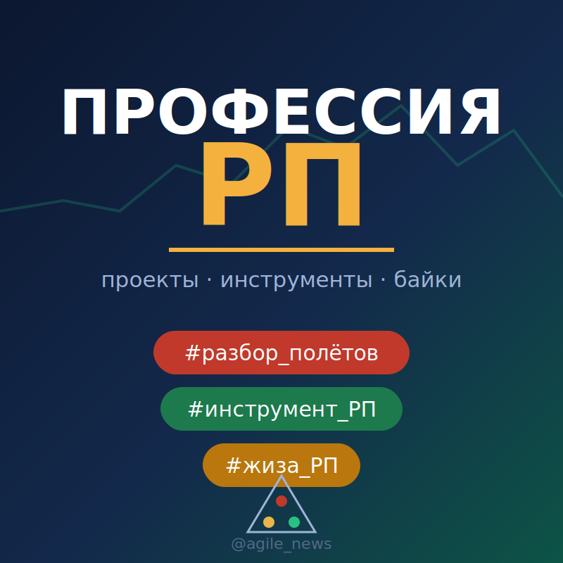

  

<h1 align="center">Профессия РП / Елена Андреева</h1>

**Руководитель проектов внедрения 1С · DIGI TEX · Самара**

21 год в ИТ: от разработчика до руководителя ИТ-отдела. Сейчас веду проекты внедрения 1С и помогаю командам разбираться с тем, что в плане-графике не видно: границами работ, данными, ролями и решениями заказчика.

Работаю с 1С:ERP, ЗУП, УТ, КА, Розницей и конфигурациями для Казахстана. Совмещаю проектное управление с техническим опытом: мне важно понять процессы клиента, собрать реалистичную оценку и довести договоренности до работающей системы. Для этой работы развиваю AI-Lab, инструмент от первого обращения до отчета об обследовании.

В канале **[«Профессия РП»](https://t.me/agile_news)** пишу о реальных проектах 1С: разбираю ошибки, спорные решения и приемы, которые помогают команде двигаться дальше. Длинные разборы публикую в [Дзене](https://dzen.ru/id/6addaa73d9d1c158a9a6ef65).

